<div align="center">

<picture>
  <source media="(prefers-color-scheme: dark)" srcset="assets/header-dark.svg">
  <source media="(prefers-color-scheme: light)" srcset="assets/header-light.svg">
  
</picture>

</div>

<div align="center">

[](https://github.com/MD-Mushfiqur123)

<br/>

[](https://github.com/MD-Mushfiqur123)
&nbsp;
[](https://github.com/MD-Mushfiqur123)
&nbsp;
[](https://github.com/MD-Mushfiqur123?tab=repositories&sort=stargazers)
&nbsp;
[](./RESUME.md)
&nbsp;
[](https://buymeacoffee.com/mdmushfiqur123)

</div>

---

<table border="0" width="100%">
<tr>
<td width="55%" valign="top">

### `> whoami`

```yaml
identity:
  name      : "Md Mushfiqur Rahim"
  role      : "SOO & Lead AI/ML Engineer @ Craftly"
  age       : 16
  location  : "Bangladesh 🇧🇩"
  education :
    - "Computer Science | University of the People, USA 🇺🇸 (Enrolled)"
    - "HSC '28 Science | Govt. Azizul Haque College 🇧🇩"

focus:
  flagship  : "Mission Mlych — 1.3B Custom SLM"
  dataset   : "Building the World's Largest Bangla LLM Dataset (Craftly Corpus)"
  research  :
    - ".MIF (Mushfiqur Image Format v2.0) — Bit-Perfect C99 Codec & libmif.h"
    - "Aether Photos Vault — Infinite Cloud Video-Encoded Photo Stream (YouTube CRF 26 Resistant)"
    - "Dataset Collector — Swiss Minimalist Scientific Distillation Forge"
    - "M-2LRF (2-bit Dual-Basis Low-Rank Residual Factorization)"
    - "DESI DR2 & JWST Cosmological Monograph (Dark Energy Equation of State)"
    - "Shadow-Omni: Multimodal vision-speech-text stream reasoning"
    - "Aero-Propulsion telemetry physics simulations"

impact:
  merged_prs : 108+ across 66+ global organizations
  downloads  : 40,000+ on HuggingFace (DropLychee)
  public_repos: 520+
```

</td>
<td width="45%" align="center" valign="middle">


<br/><br/>

<i>"Throughout heaven and earth,<br/>continuous innovation alone is honored."</i>

<br/><br/>

[](https://github.com/MD-Mushfiqur123)
[](mailto:20mahin2020@gmail.com)
<br/>
[](https://huggingface.co/DropLychee)
[](https://huggingface.co/MD-Mushfiqur123)
<br/>
[](https://leetcode.com/u/mushfiqurH2B/)
[](https://www.hackerrank.com/profile/20mahin2020)
[](https://facebook.com/100090048324727)

</td>
</tr>
</table>

---

## 🌟 Open Source Infrastructure Contributions

> Production contributions merged into industry-critical systems:

<div align="center">

| Project | Domain | Scale |
| :--- | :--- | :---: |
| 🐳 **[Docker — moby/moby](https://github.com/moby/moby)** | Core Container Runtime Engine | 69.8k ⭐ |
| 🔍 **[Google — google/go-cmp](https://github.com/google/go-cmp)** | Official Go Equality & Diff Package | 4.1k ⭐ |
| ☁️ **[AWS Labs — awslabs/mcp](https://github.com/awslabs/mcp)** | Model Context Protocol for AWS Infra | AWS Official |
| 📊 **[CNCF — prometheus/client_golang](https://github.com/prometheus/client_golang)** | Cloud-Native Metrics & Monitoring | 5.3k ⭐ |
| ⚙️ **[CNCF — etcd-io/raft](https://github.com/etcd-io/raft)** | Kubernetes Core Raft Consensus | 4.8k ⭐ |
| ⚡ **[GoFiber — gofiber/fiber](https://github.com/gofiber/fiber)** | Ultra-fast Express-inspired Go Framework | 35.5k ⭐ |
| 🐚 **[Oh My Zsh — ohmyzsh/ohmyzsh](https://github.com/ohmyzsh/ohmyzsh)** | World's Most Popular CLI Framework | 175k ⭐ |
| 🗄️ **[ClickHouse — clickhouse-go](https://github.com/ClickHouse/clickhouse-go)** | Real-time Analytical Database Driver | 1.8k ⭐ |

</div>

---

## 🚀 Flagship Research & Sovereign Systems Architecture

<div align="center">

| Project / Monograph | Domain & Core Innovation | Architecture & Proof |
| :--- | :--- | :---: |
| 🖼️ **[mif-image-format](https://github.com/MD-Mushfiqur123/mif-image-format)** | **Mushfiqur Image Format (.MIF v2.0):** Single-header C99 codec (`libmif.h`), scanline spatial residual predictors (Sub, Up, Avg, Paeth), 100% bit-perfect CRC-32 & SHA-256 verified, beats PNG on flat art. | `v2.0.0` • C99 / Python |
| 📸 **[aether-photos-vault](https://github.com/MD-Mushfiqur123/aether-photos-vault)** | **Infinite YouTube Binary Photo Vault:** Converts photo batches into 1080p MP4 optical streams with center-pixel sampling. Immune to YouTube CRF 26 compression with 100% bit-perfect recovery. | `v1.0.0` • Video Codec |
| 🔬 **[dataset-collector](https://github.com/MD-Mushfiqur123/dataset-collector)** | **Scientific Bengali Dataset Distillation Forge:** Swiss Minimalist architecture, 1-Paste intelligent auto-split, 83% Jaccard duplicate gatekeeper, 1 GB buffer watchdog, 1-click Codespaces & Colab runners. | `v1.0.0` • OWASP 6/6 Pass |
| 👑 **[m2lrf](https://github.com/MD-Mushfiqur123/m2lrf)** | **M-2LRF Silicon Architecture:** Multi-rate low-rank factorization & 2-bit dual-basis ternary quantization engine eliminating multiplier hardware overhead. | Verified Engine |
| 🔭 **[Cosmology Monograph](https://github.com/MD-Mushfiqur123/DESI-DR2-JWST-Cosmology-Monograph)** | **The Architecture of the Cosmos:** 48-page theoretical and observational monograph analyzing dynamical dark energy equation of state ($w_0, w_a$) and $H_0$ tensions from DESI DR2 BAO & JWST. | 48-Page Monograph |

</div>

---

## 🛠️ Mastered Technologies & Engineering Sectors

<div align="center">

#### 💻 Programming Languages & Systems
<a href="https://skillicons.dev">
  
</a>

<br/>

#### 🧠 Artificial Intelligence, Machine Learning & Vision
<a href="https://skillicons.dev">
  
</a>

<br/>

#### 🌐 Full-Stack Web Architecture & Frameworks
<a href="https://skillicons.dev">
  
</a>

<br/>

#### ☁️ Cloud Platforms, DevOps & Containerization
<a href="https://skillicons.dev">
  
</a>

<br/>

#### 🗄️ Database Systems, In-Memory & Streaming
<a href="https://skillicons.dev">
  
</a>

<br/>

#### ⚡ Developer Tooling, CI/CD & Version Control
<a href="https://skillicons.dev">
  
</a>

</div>

---

## ⚡ GitHub Metrics & Analytics

<div align="center">

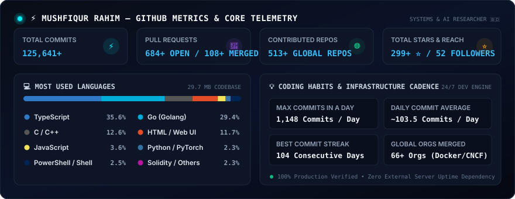

</div>

---

## 🗺️ 3D Contribution Landscape

<div align="center">

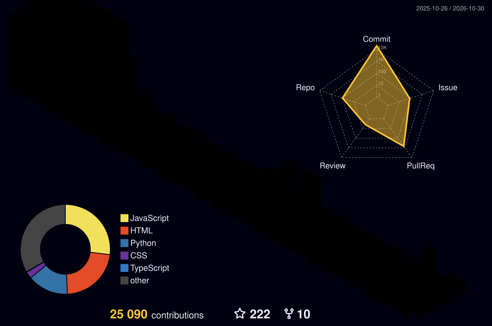

</div>

---

---

## 🌲 Living Minecraft Contribution Biome

<div align="center">

<a href="https://github.com/MD-Mushfiqur123">
  
</a>

</div>

---

## 🟢 Cyber Matrix Contribution Rain

<div align="center">

<picture>
  <source media="(prefers-color-scheme: dark)" srcset="https://raw.githubusercontent.com/MD-Mushfiqur123/MD-Mushfiqur123/output/matrix-rain-v2-dark.svg">
  <source media="(prefers-color-scheme: light)" srcset="https://raw.githubusercontent.com/MD-Mushfiqur123/MD-Mushfiqur123/output/matrix-rain-v2-light.svg">
  
</picture>

</div>

## 🐍 Contribution Snake

<div align="center">

<picture>
  <source media="(prefers-color-scheme: dark)"  srcset="https://raw.githubusercontent.com/MD-Mushfiqur123/MD-Mushfiqur123/output/github-snake-dark.svg" />
  <source media="(prefers-color-scheme: light)" srcset="https://raw.githubusercontent.com/MD-Mushfiqur123/MD-Mushfiqur123/output/github-snake-light.svg" />
  
</picture>

</div>

---

## 🏆 GitHub Trophies & Milestones

<div align="center">

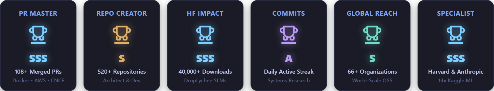

<br/><br/>

[](https://github.com/MD-Mushfiqur123)

</div>

---

## 👾 Pacman Devourer & Matrix Contribution Track

<div align="center">


</div>

---

## 📈 30-Day Contribution Pulse Line Graph

<div align="center">


</div>

---

## ✍️ Dev Wisdom

<div align="center">

[](https://github.com/piyushsuthar/github-readme-quotes)

</div>

---

## 🎓 Verified Certifications & Credentials

### 🏛️ Top Universities & Global Computer Science Programs

<table border="0" width="100%">
  <tr>
    <td width="50%" align="center" valign="top">
      <a href="https://cs50.harvard.edu/certificates/9fde6ff7-e81e-4c04-89cf-735b736004dd">
        
      </a>
      <br/><br/>
      <a href="https://cs50.harvard.edu/certificates/9fde6ff7-e81e-4c04-89cf-735b736004dd">
        
      </a>
    </td>
    <td width="50%" align="center" valign="top">
      <a href="https://studies.cs.helsinki.fi/stats/api/certificate/fullstackopen/en/2459f5ce85ad3bee10459f37870e8c84">
        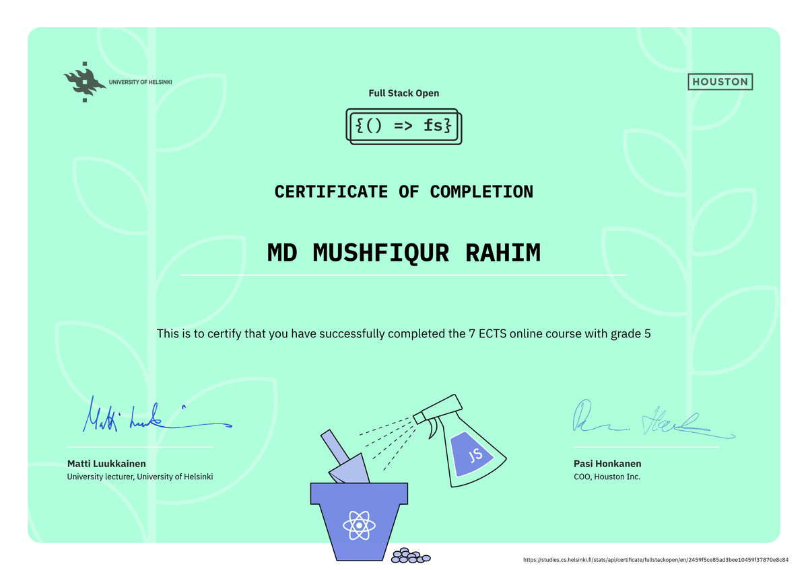
      </a>
      <br/><br/>
      <a href="https://studies.cs.helsinki.fi/stats/api/certificate/fullstackopen/en/2459f5ce85ad3bee10459f37870e8c84">
        
      </a>
    </td>
  </tr>
  <tr>
    <td width="50%" align="center" valign="top">
      <a href="https://certificates.mooc.fi/validate/1xw084tnsab">
        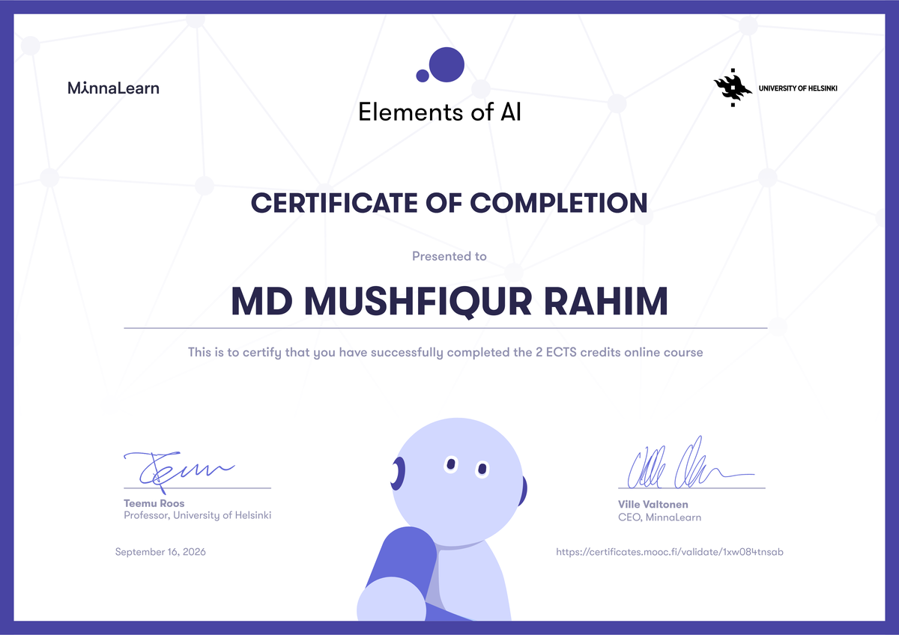
      </a>
      <br/><br/>
      <a href="https://certificates.mooc.fi/validate/1xw084tnsab">
        
      </a>
      &nbsp;
      
    </td>
    <td width="50%" align="center" valign="top">
      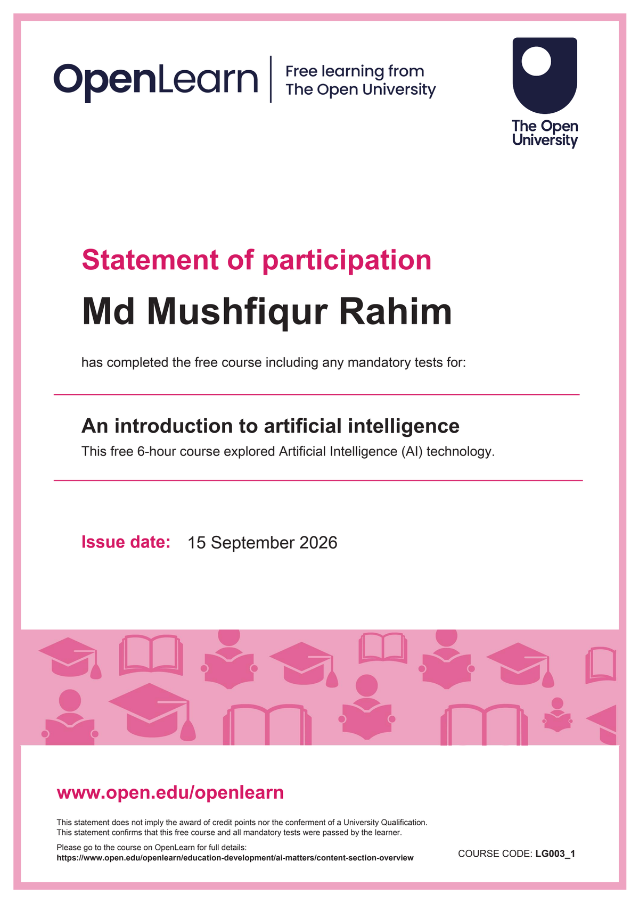
      <br/><br/>
      
    </td>
  </tr>
  <tr>
    <td width="50%" align="center" valign="top">
      <a href="https://cs50.harvard.edu/certificates/6d46d2bc-3bfa-418d-9623-9378ed43dbfa">
        
      </a>
      <br/><br/>
      <a href="https://cs50.harvard.edu/certificates/6d46d2bc-3bfa-418d-9623-9378ed43dbfa">
        
      </a>
    </td>
    <td width="50%" align="center" valign="top">
      <a href="https://cs50.harvard.edu/certificates/e2666653-f57a-48ff-bfef-a32c3b5eca04">
        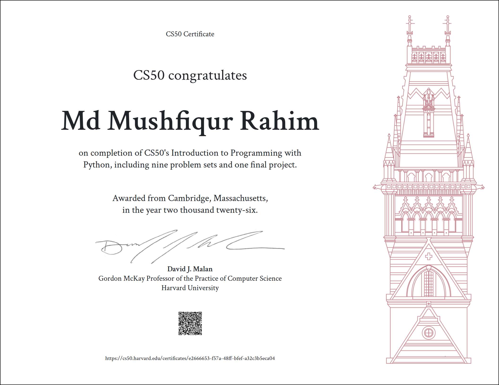
      </a>
      <br/><br/>
      <a href="https://cs50.harvard.edu/certificates/e2666653-f57a-48ff-bfef-a32c3b5eca04">
        
      </a>
    </td>
  </tr>
    <tr>
    <td width="50%" align="center" valign="top">
      <a href="https://cs50.harvard.edu/certificates/7bb2e6da-6179-4044-893e-dd4aee53d13f">
        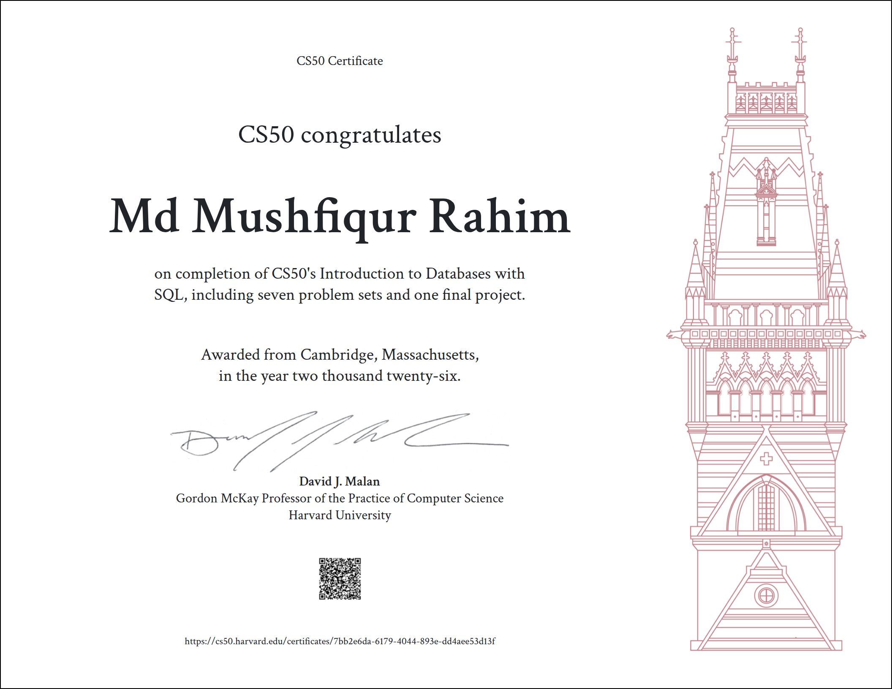
      </a>
      <br/><br/>
      <a href="https://cs50.harvard.edu/certificates/7bb2e6da-6179-4044-893e-dd4aee53d13f">
        
      </a>
    </td>
    <td width="50%" align="center" valign="top">
      <a href="https://cs50.harvard.edu/certificates">
        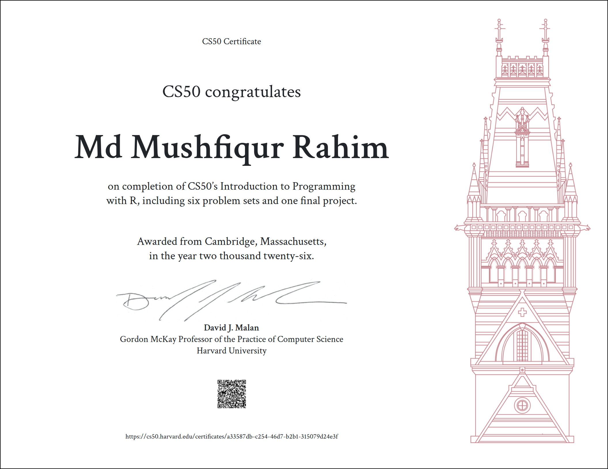
      </a>
      <br/><br/>
      <a href="https://cs50.harvard.edu/certificates">
        
      </a>
    </td>
  </tr>
</table>

<br/>

### 🇪🇺 European University ECTS Credits (20.0 ECTS In-Hand | Bologna Process Validated)

<div align="center">
  
  &nbsp;
  
</div>

<br/>

<table border="0" width="100%">
  <tr>
    <td width="50%" align="center" valign="top">
      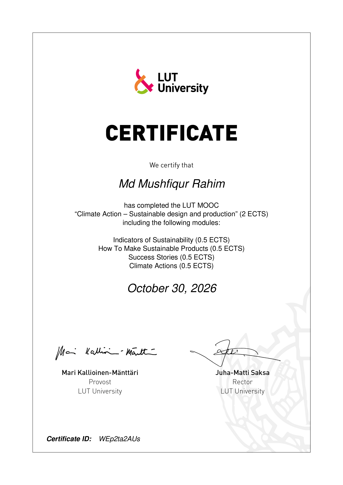
      <br/><br/>
      
      <br/>
      <sub><b>Official Certificate ID:</b> <code>WEp2ta2AUs</code></sub>
    </td>
    <td width="50%" align="center" valign="top">
      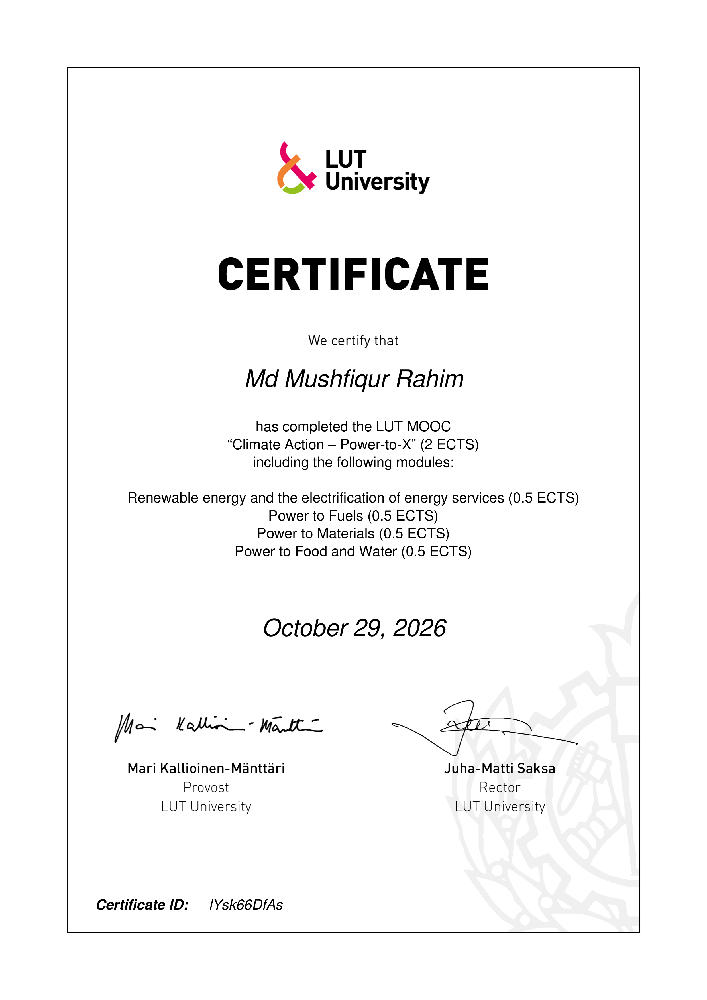
      <br/><br/>
      
      <br/>
      <sub><b>Official Certificate ID:</b> <code>lYsk66DfAs</code></sub>
    </td>
  </tr>
  <tr>
    <td width="50%" align="center" valign="top">
      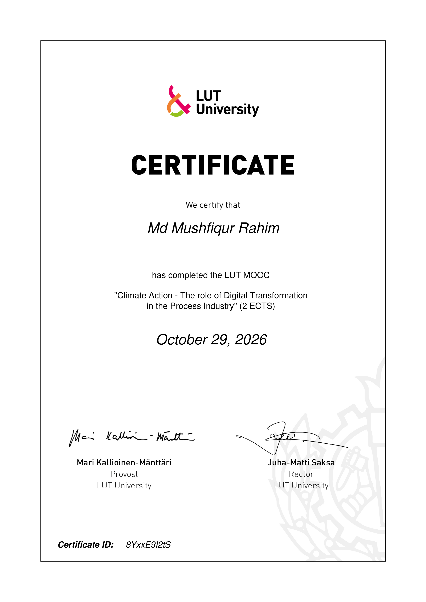
      <br/><br/>
      
      <br/>
      <sub><b>Official Certificate ID:</b> <code>8YxxE9I2tS</code></sub>
    </td>
    <td width="50%" align="center" valign="top">
      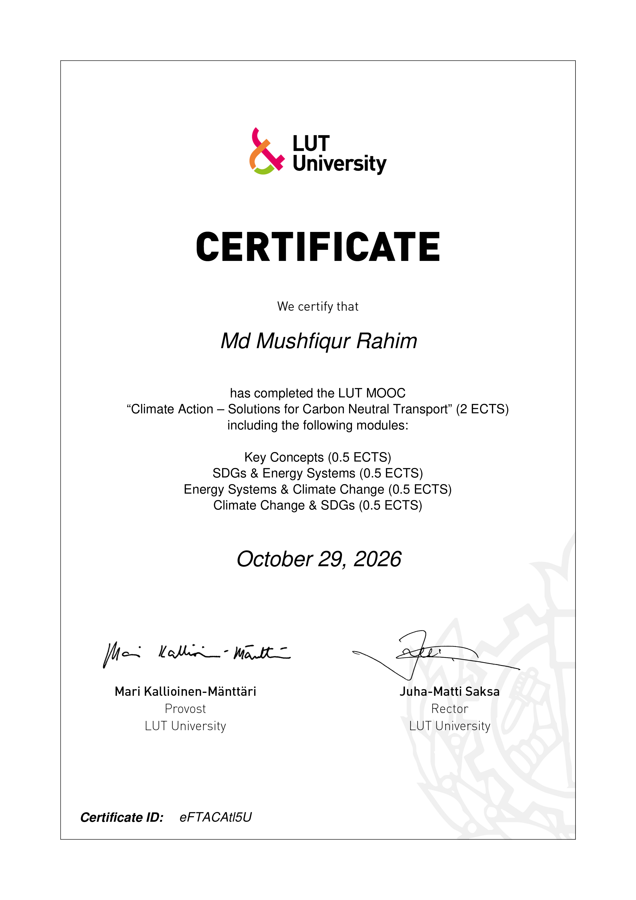
      <br/><br/>
      
      <br/>
      <sub><b>Official Certificate ID:</b> <code>eFTACAtl5U</code></sub>
    </td>
  </tr>
  <tr>
    <td width="50%" align="center" valign="top">
      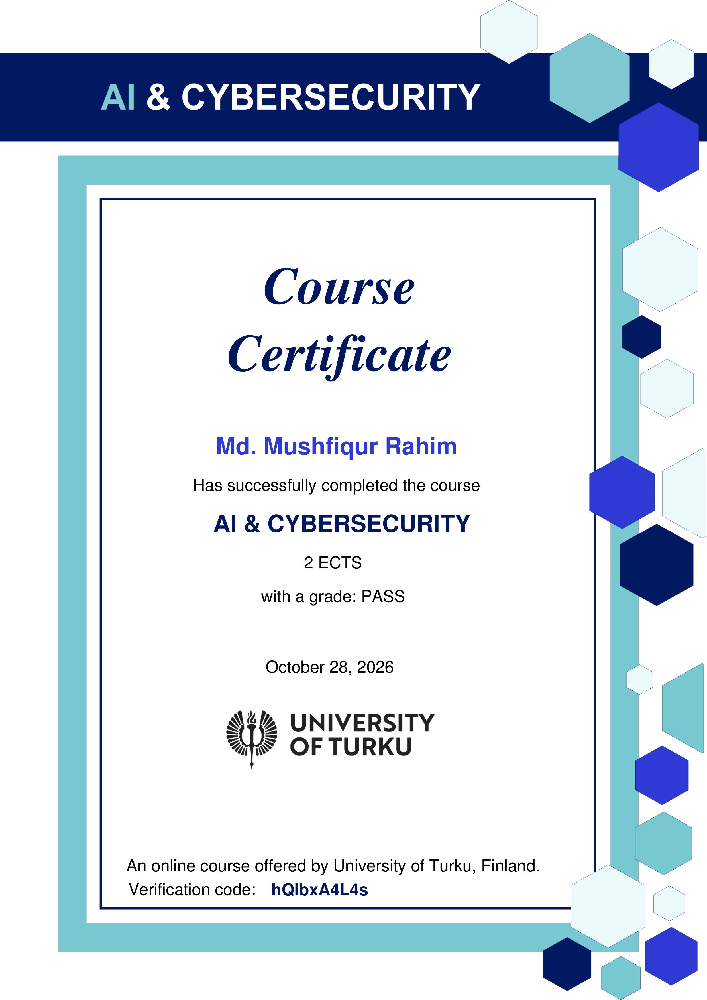
      <br/><br/>
      
      <br/>
      <sub><b>Official Certificate ID:</b> <code>hQIbxA4L4s</code></sub>
    </td>
    <td width="50%" align="center" valign="top">
      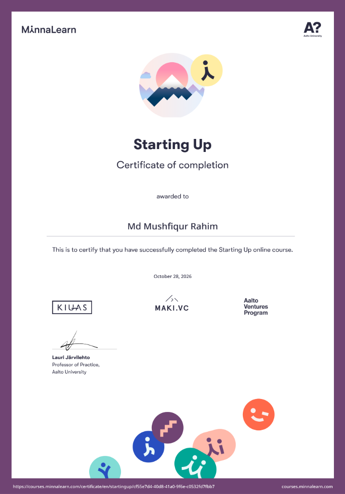
      <br/><br/>
      
      <br/>
      <sub><b>Online Verification ID:</b> <code>cf55e7d4-40d8-41a0-9f6e-c0532fd7fbb7</code></sub>
    </td>
  </tr>
</table>

<br/>


<br/>

### ⚛️ International Atomic Energy Agency (IAEA Vienna) — Nuclear Medicine & Radiation Protection

<div align="center">

&nbsp;

&nbsp;

</div>

<br/>

<table border="0" width="100%">
<tr>
<td width="100%" align="center" valign="top">
<a href="https://elearning.iaea.org/">

</a>
<br/><br/>
<a href="https://elearning.iaea.org/">

</a>
<br/>
<sub><b>Issuing Authority:</b> International Atomic Energy Agency (IAEA, Vienna) | <b>Recipient:</b> Md Mushfiqur Rahim | <b>Completed:</b> October 31, 2026</sub>
</td>
</tr>
</table>

<br/>

### 🩺 Global Clinical Medicine & Public Health (WHO, PAHO & U.S. NIH)

<div align="center">

&nbsp;

&nbsp;

</div>

<br/>

<table border="0" width="100%">
<tr>
<td width="50%" align="center" valign="top">
<a href="https://campus.paho.org/mooc/mod/simplecertificate/verify.php?code=7e68d0d7-0da6-4ca1-a9fa-4900f3aa19af">
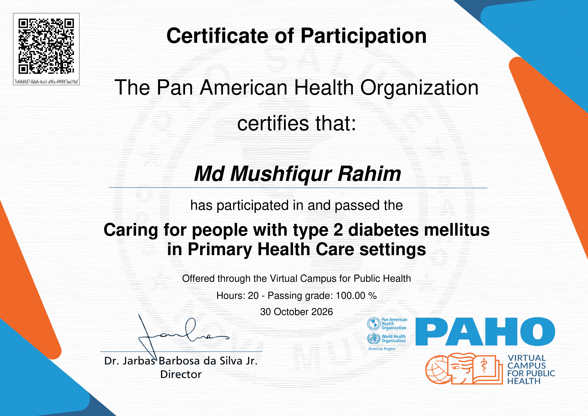
</a>
<br/><br/>
<a href="https://campus.paho.org/mooc/mod/simplecertificate/verify.php?code=7e68d0d7-0da6-4ca1-a9fa-4900f3aa19af">

</a>
<br/>
<sub><b>Verification Code:</b> <code>7e68d0d7-0da6-4ca1-a9fa-4900f3aa19af</code> | <b>Grade:</b> 100.00% | <b>Hours:</b> 20 Hours | <a href="https://campus.paho.org/mooc/mod/simplecertificate/verify.php?code=7e68d0d7-0da6-4ca1-a9fa-4900f3aa19af"><b>Verify Authenticity</b></a></sub>
</td>
<td width="50%" align="center" valign="top">
<a href="https://campus.paho.org/mooc/mod/simplecertificate/verify.php?code=8f099a5f-90c3-4112-a046-84fd4ef981f2">
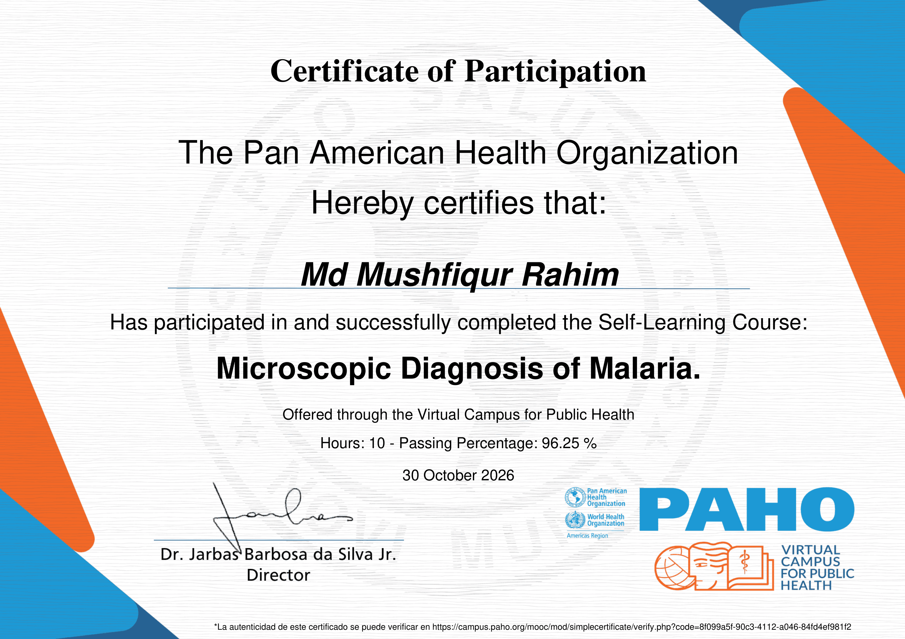
</a>
<br/><br/>
<a href="https://campus.paho.org/mooc/mod/simplecertificate/verify.php?code=8f099a5f-90c3-4112-a046-84fd4ef981f2">

</a>
<br/>
<sub><b>Verification Code:</b> <code>8f099a5f-90c3-4112-a046-84fd4ef981f2</code> | <b>Grade:</b> 96.25% | <b>Hours:</b> 10 Hours | <a href="https://campus.paho.org/mooc/mod/simplecertificate/verify.php?code=8f099a5f-90c3-4112-a046-84fd4ef981f2"><b>Verify Authenticity</b></a></sub>
</td>
</tr>
<tr>
<td width="50%" align="center" valign="top">
<a href="https://campus.paho.org/mooc/mod/simplecertificate/verify.php?code=0215350c-7210-4ab5-9a05-9f2dcf3194fa">
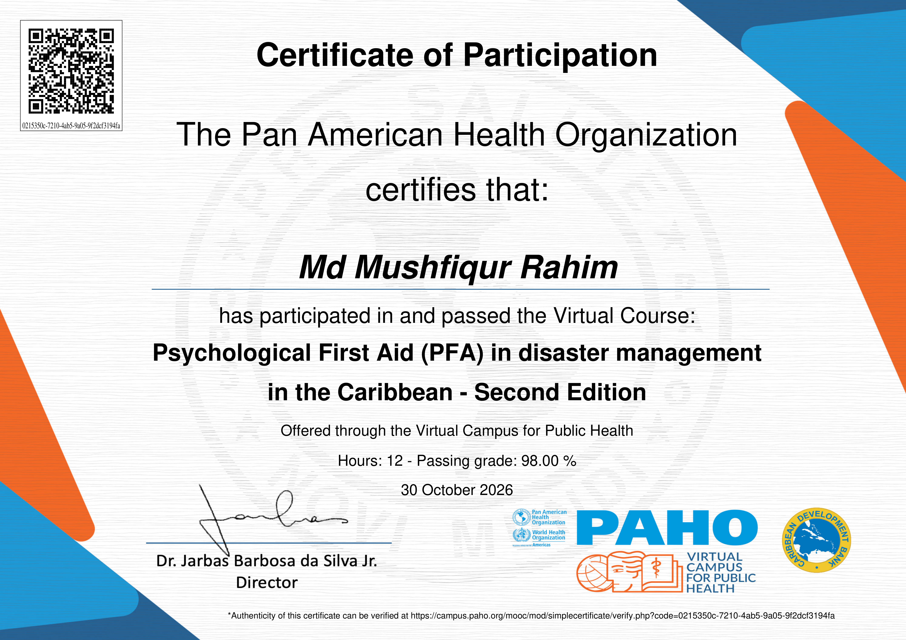
</a>
<br/><br/>
<a href="https://campus.paho.org/mooc/mod/simplecertificate/verify.php?code=0215350c-7210-4ab5-9a05-9f2dcf3194fa">

</a>
<br/>
<sub><b>Verification Code:</b> <code>0215350c-7210-4ab5-9a05-9f2dcf3194fa</code> | <b>Grade:</b> 98.00% | <b>Hours:</b> 12 Hours | <a href="https://campus.paho.org/mooc/mod/simplecertificate/verify.php?code=0215350c-7210-4ab5-9a05-9f2dcf3194fa"><b>Verify Authenticity</b></a></sub>
</td>
<td width="50%" align="center" valign="top">
<a href="https://ocrtraining.cit.nih.gov/">
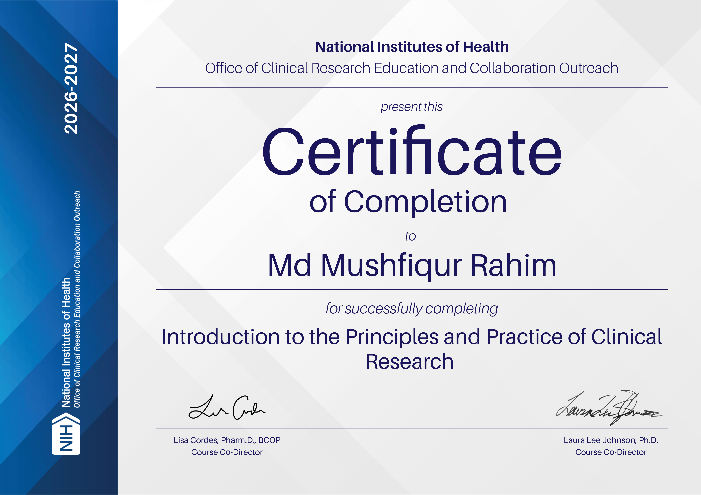
</a>
<br/><br/>
<a href="https://ocrtraining.cit.nih.gov/">

</a>
<br/>
<sub><b>Issuing Authority:</b> National Institutes of Health (NIH), Bethesda, Maryland, USA</sub>
</td>
</tr>
<tr>
<td width="50%" align="center" valign="top">
<a href="https://ocrtraining.cit.nih.gov/">

</a>
<br/><br/>
<a href="https://ocrtraining.cit.nih.gov/">

</a>
<br/>
<sub><b>Issuing Authority:</b> National Institutes of Health (NIH), Bethesda, Maryland, USA</sub>
</td>
<td width="50%" align="center" valign="top">
<a href="https://www.unssc.org/">
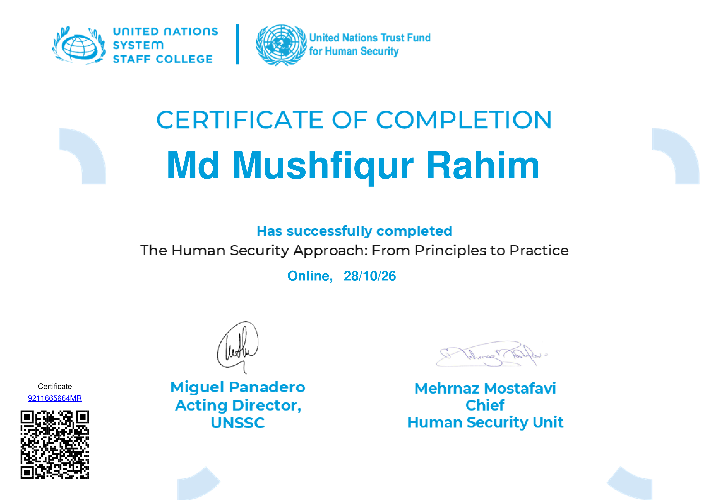
</a>
<br/><br/>
<a href="https://www.unssc.org/">

</a>
<br/>
<sub><b>Official Certificate Code:</b> <code>9211665664MR</code> | UN Trust Fund for Human Security</sub>
</td>
</tr>
<tr>
<td width="50%" align="center" valign="top">
<a href="https://training.fema.gov/is/crslist.aspx?lang=en">
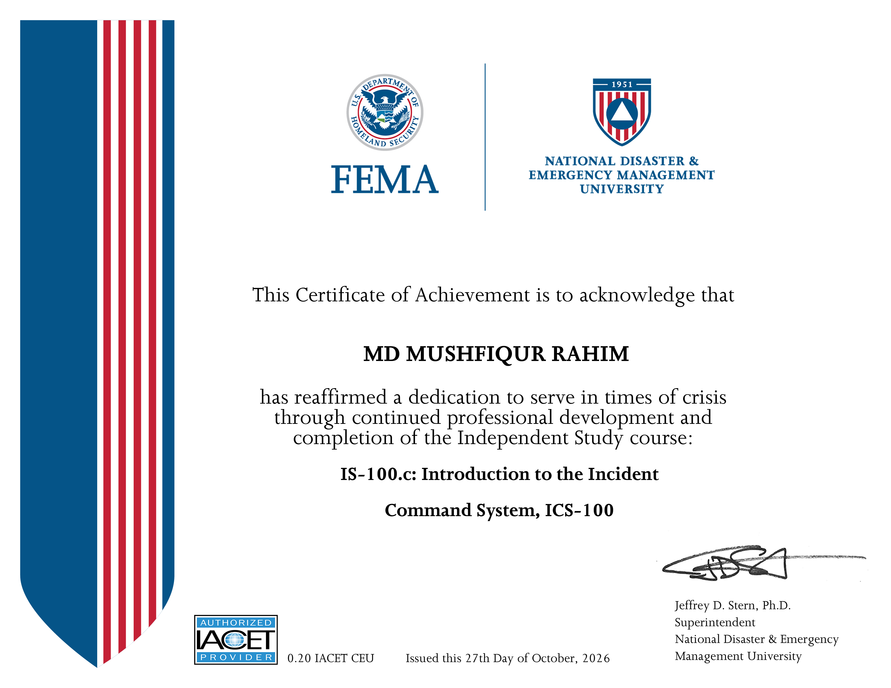
</a>
<br/><br/>
<a href="https://training.fema.gov/is/crslist.aspx?lang=en">

</a>
<br/>
<sub><b>Official FEMA SID:</b> <code>SID-0010388526</code> | 0.2 IACET CEU</sub>
</td>
<td width="50%" align="center" valign="top">
<a href="https://www.opswat.com/academy">
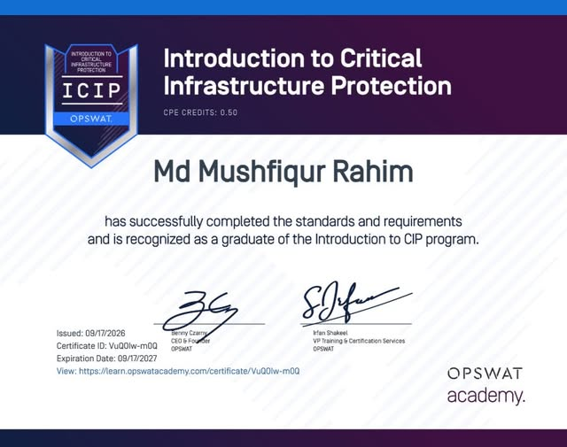
</a>
<br/><br/>
<a href="https://www.opswat.com/academy">

</a>
<br/>
<sub><b>Official Credential ID:</b> <code>65a0b7e289f31a00192e8a71</code></sub>
</td>
</tr>
</table>

<br/>

### ⚡ HackerRank Official Role Certifications & Skills Mastery

<div align="center">
  
  &nbsp;
  
</div>

<br/>

<table border="0" width="100%">
  <tr>
    <td width="50%" align="center" valign="top">
      <a href="https://www.hackerrank.com/certificates">
        
      </a>
      <br/><br/>
      
    </td>
    <td width="50%" align="center" valign="top">
      <a href="https://www.hackerrank.com/certificates">
        
      </a>
      <br/><br/>
      
    </td>
  </tr>
  <tr>
    <td width="50%" align="center" valign="top">
      <a href="https://www.hackerrank.com/certificates">
        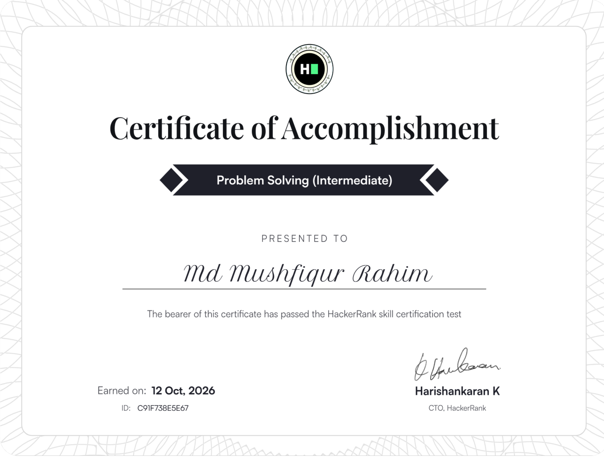
      </a>
      <br/><br/>
      
    </td>
    <td width="50%" align="center" valign="top">
      <a href="https://www.hackerrank.com/certificates">
        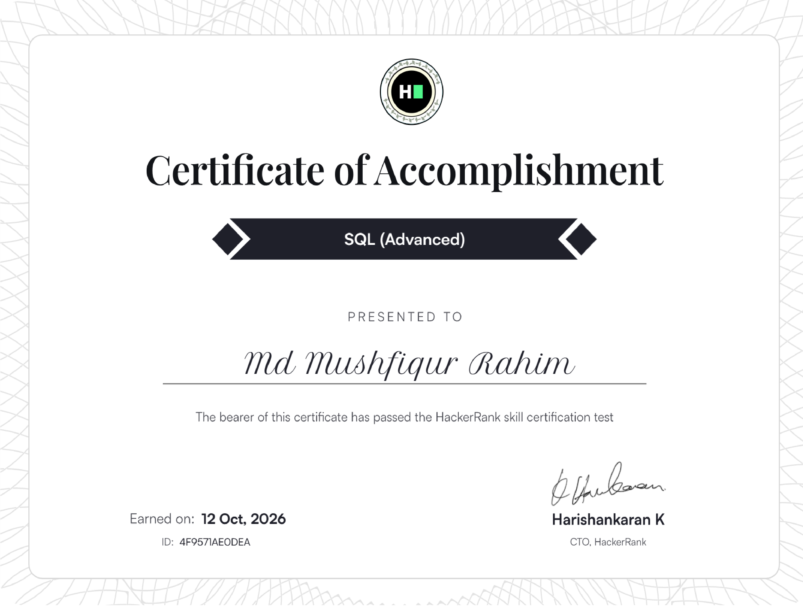
      </a>
      <br/><br/>
      
    </td>
  </tr>
  <tr>
    <td width="50%" align="center" valign="top">
      <a href="https://www.hackerrank.com/certificates">
        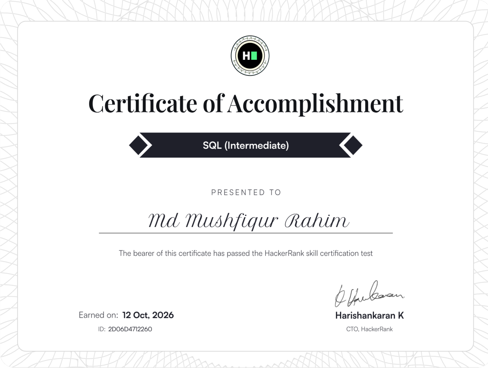
      </a>
      <br/><br/>
      
    </td>
    <td width="50%" align="center" valign="top">
      <a href="https://www.hackerrank.com/certificates">
        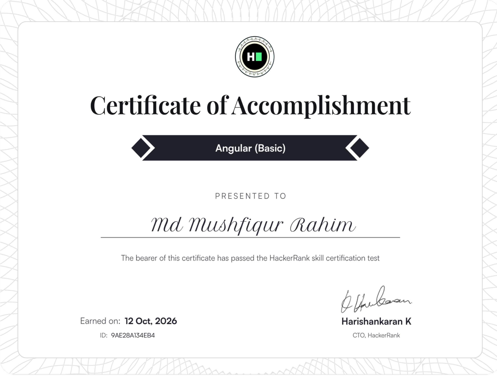
      </a>
      <br/><br/>
      
    </td>
  </tr>
</table>


<br/>

### 📊 Kaggle & Google Cloud Verified ML Specializations (14+ Certificates)

<div align="center">
  
  &nbsp;
  
</div>

<br/>

<table border="0" width="100%">
  <tr>
    <td width="50%" align="center" valign="top">
      
      <br/><br/>
      
    </td>
    <td width="50%" align="center" valign="top">
      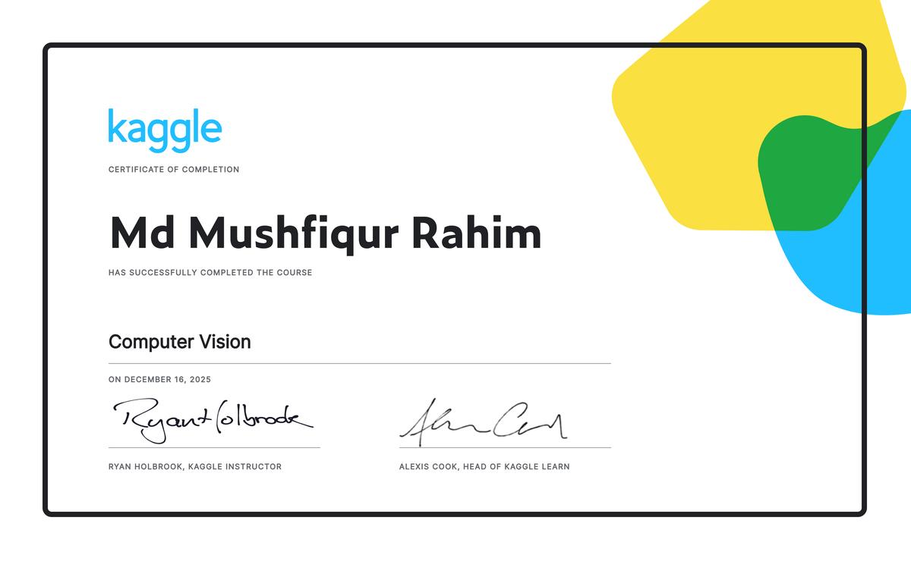
      <br/><br/>
      
    </td>
  </tr>
  <tr>
    <td width="50%" align="center" valign="top">
      
      <br/><br/>
      
    </td>
    <td width="50%" align="center" valign="top">
      
      <br/><br/>
      
    </td>
  </tr>
  <tr>
    <td width="50%" align="center" valign="top">
      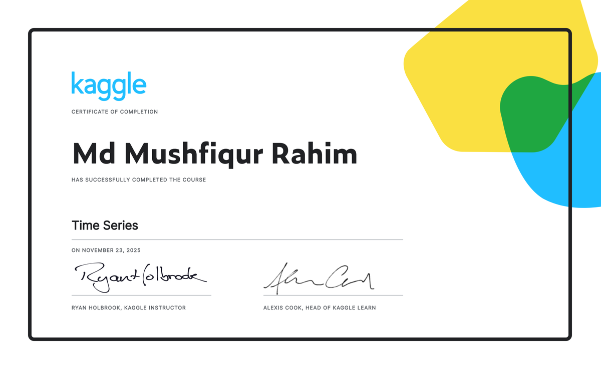
      <br/><br/>
      
    </td>
    <td width="50%" align="center" valign="top">
      
      <br/><br/>
      
    </td>
  </tr>
  <tr>
    <td width="50%" align="center" valign="top">
      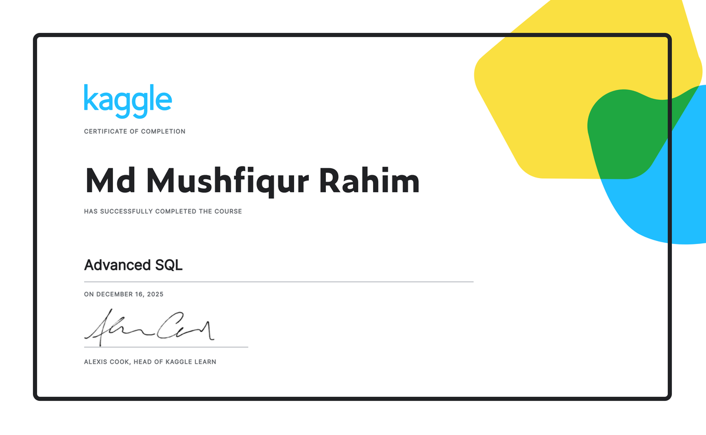
      <br/><br/>
      
    </td>
    <td width="50%" align="center" valign="top">
      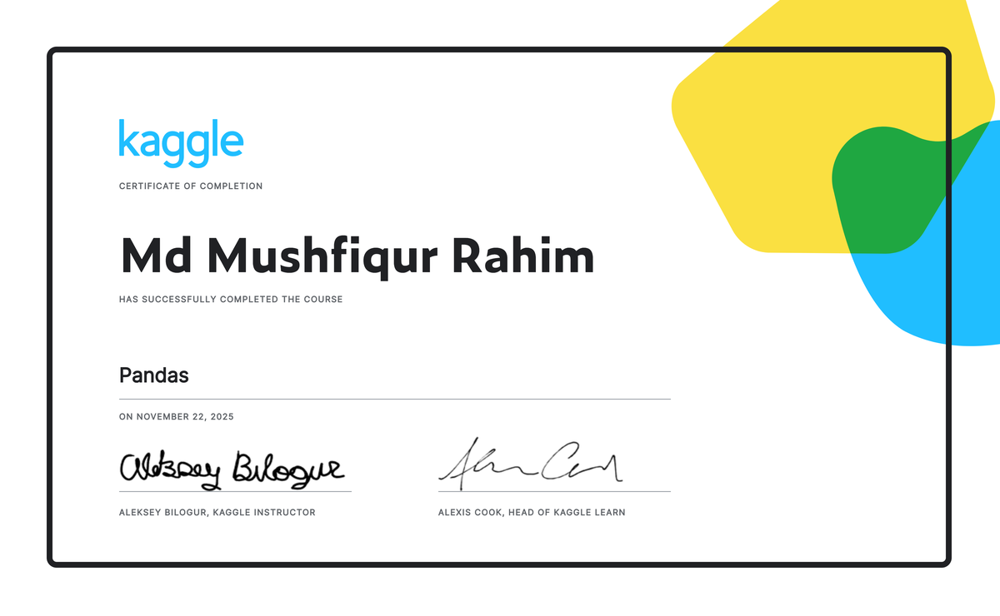
      <br/><br/>
      
    </td>
  </tr>
</table>


<br/>

### 🛸 NASA (National Aeronautics and Space Administration) — Applied Remote Sensing & Space Systems

<div align="center">

  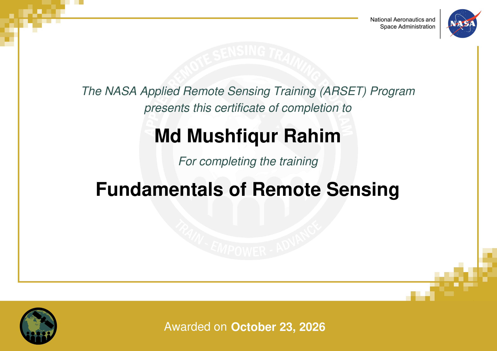

<br/><br/>


&nbsp;

&nbsp;


</div>

<br/>

### 🇺🇳 United Nations (UNODC Vienna) — Certified International Legal Standards

<div align="center">

<a href="https://elearningunodc.org/pluginfile.php/1/tool_certificate/issues/1792789961/9470307475MR.pdf">
  
</a>

<br/><br/>

<a href="https://elearningunodc.org/pluginfile.php/1/tool_certificate/issues/1792789961/9470307475MR.pdf">
  
</a>
&nbsp;
<a href="https://elearningunodc.org/pluginfile.php/1/tool_certificate/issues/1792789961/9470307475MR.pdf">
  
</a>
&nbsp;
<a href="https://elearningunodc.org/pluginfile.php/1/tool_certificate/issues/1792789961/9470307475MR.pdf">
  
</a>

</div>

<br/>

### 🤖 Anthropic AI — Certified Developer

<div align="center">

| Certificate | Issuer | Verification |
| :--- | :--- | :---: |
| **Claude Code in Action** | Anthropic | [↗ View Credential](https://verify.skilljar.com/c/qp3mi4hhbpdk) |
| **Claude with Google Vertex AI** | Anthropic | [↗ View Credential](https://verify.skilljar.com/c/6euhyoyfxevg) |
| **Claude 101** | Anthropic | ✅ Verified |
| **Claude Code 101** | Anthropic | ✅ Verified |
| **AI Fluency for Students** | Anthropic × UCC × Ringling × HEA | ✅ Verified |
| **AI Fluency: Framework & Foundations** | Anthropic × UCC × Ringling × HEA | ✅ Verified |

</div>

<br/>

### 🌐 Official Qualifications & Accreditations

<table border="0" width="100%">
  <tr>
    <td width="42%" align="center" valign="middle">
      <a href="https://cert.efset.org/G7yoSe">
        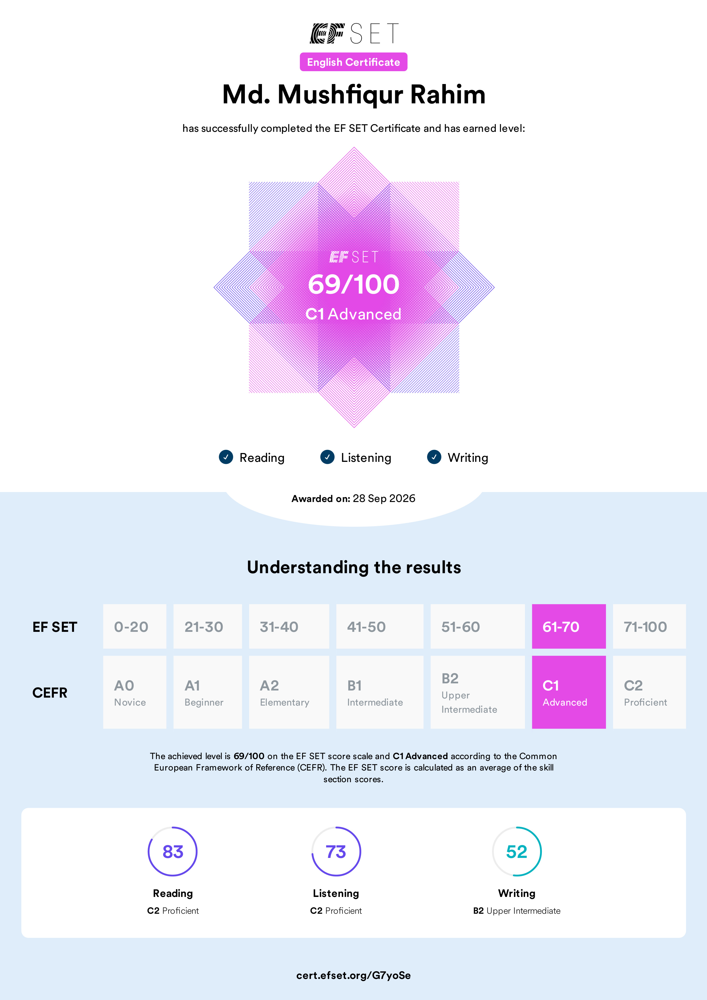
      </a>
      <br/><br/>
      <a href="https://cert.efset.org/G7yoSe"></a>
    </td>
    <td width="58%" align="center" valign="middle">
      <a href="https://www.skills.google/public_profiles/f65660d4-2a1e-48ba-8431-998055be793a">
        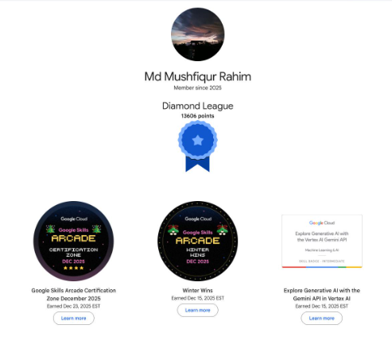
      </a>
      <br/><br/>
      <a href="https://www.skills.google/public_profiles/f65660d4-2a1e-48ba-8431-998055be793a"></a>
    </td>
  </tr>
</table>

<br/>

### ⚡ LeetCode — Algorithmic Mastery & Official Study Plan Badges

<div align="center">

<a href="https://leetcode.com/u/mushfiqurH2B/">
  
</a>
<a href="https://leetcode.com/u/mushfiqurH2B/">
  
</a>
<a href="https://leetcode.com/u/mushfiqurH2B/">
  
</a>
<a href="https://leetcode.com/u/mushfiqurH2B/">
  
</a>
<a href="https://leetcode.com/u/mushfiqurH2B/">
  
</a>

<br/><br/>

<table border="0" width="100%">
  <tr>
    <td width="25%" align="center" valign="top">
      <a href="https://leetcode.com/u/mushfiqurH2B/">
        
      </a>
      <br/><br/>
      <a href="https://leetcode.com/u/mushfiqurH2B/"></a>
    </td>
    <td width="25%" align="center" valign="top">
      <a href="https://leetcode.com/u/mushfiqurH2B/">
        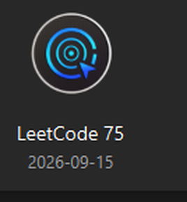
      </a>
      <br/><br/>
      <a href="https://leetcode.com/u/mushfiqurH2B/"></a>
    </td>
    <td width="25%" align="center" valign="top">
      <a href="https://leetcode.com/u/mushfiqurH2B/">
        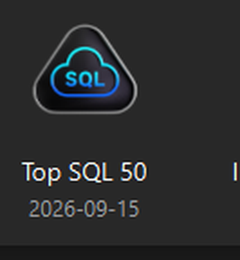
      </a>
      <br/><br/>
      <a href="https://leetcode.com/u/mushfiqurH2B/"></a>
    </td>
    <td width="25%" align="center" valign="top">
      <a href="https://leetcode.com/u/mushfiqurH2B/">
        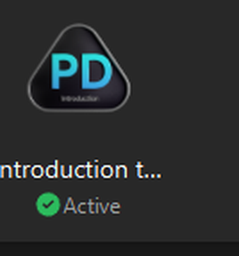
      </a>
      <br/><br/>
      <a href="https://leetcode.com/u/mushfiqurH2B/"></a>
    </td>
  </tr>
</table>

</div>

<br/>

### 🏆 HackerRank — Verified Certifications & Multi-Domain Badges

<div align="center">

<a href="https://www.hackerrank.com/profile/20mahin2020">
  
</a>
<a href="https://www.hackerrank.com/profile/20mahin2020">
  
</a>
<a href="https://www.hackerrank.com/profile/20mahin2020">
  
</a>

<br/><br/>

#### 📜 Official Verified Skill & Role Certifications
<table border="0" width="100%">
  <tr>
    <td width="50%" align="center" valign="top">
      <b>🏅 SQL (Advanced)</b><br/>
      <code>Score: 200/200 (100%)</code><br/>
      <a href="https://www.hackerrank.com/certificates/4f9571ae0dea">
        
      </a>
      <br/><br/>
      <a href="https://www.hackerrank.com/certificates/4f9571ae0dea">
        
      </a>
    </td>
    <td width="50%" align="center" valign="top">
      <b>🏅 SQL (Intermediate)</b><br/>
      <code>Score: 150/150 (100%)</code><br/>
      <a href="https://www.hackerrank.com/certificates/2d06d4712260">
        
      </a>
      <br/><br/>
      <a href="https://www.hackerrank.com/certificates/2d06d4712260">
        
      </a>
    </td>
  </tr>
  <tr>
    <td width="50%" align="center" valign="top">
      <b>🏅 Problem Solving (Intermediate)</b><br/>
      <code>Score: 150/150 (100%)</code><br/>
      <a href="https://www.hackerrank.com/certificates/c91f738e5e67">
        
      </a>
      <br/><br/>
      <a href="https://www.hackerrank.com/certificates/c91f738e5e67">
        
      </a>
    </td>
    <td width="50%" align="center" valign="top">
      <b>🏅 Software Engineer Intern</b><br/>
      <code>Score: 100/100 (100%)</code><br/>
      <a href="https://www.hackerrank.com/certificates/3382e9d12662">
        
      </a>
      <br/><br/>
      <a href="https://www.hackerrank.com/certificates/3382e9d12662">
        
      </a>
    </td>
  </tr>
  <tr>
    <td colspan="2" align="center" valign="top">
      <b>🏅 Angular (Basic)</b><br/>
      <code>Score: 100/100 (100%)</code><br/>
      <a href="https://www.hackerrank.com/certificates/9ae28a134eb4">
        
      </a>
      <br/><br/>
      <a href="https://www.hackerrank.com/certificates/9ae28a134eb4">
        
      </a>
    </td>
  </tr>
</table>

<br/>

#### ⭐ Multi-Domain Mastery Badges (7x Gold 5-Star & 1x Silver)

<table border="0" width="100%">
  <tr>
    <td width="25%" align="center" valign="top">
      <a href="https://www.hackerrank.com/profile/20mahin2020">
        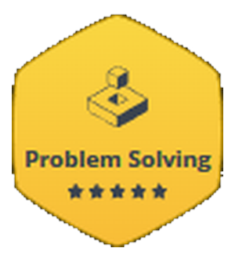
      </a>
      <br/><br/>
      <b>Problem Solving</b><br/>
      <a href="https://www.hackerrank.com/profile/20mahin2020"></a><br/>
      <small><code>2,161 pts • 91 Solved</code></small>
    </td>
    <td width="25%" align="center" valign="top">
      <a href="https://www.hackerrank.com/profile/20mahin2020">
        
      </a>
      <br/><br/>
      <b>SQL</b><br/>
      <a href="https://www.hackerrank.com/profile/20mahin2020"></a><br/>
      <small><code>880 pts • 51 Solved</code></small>
    </td>
    <td width="25%" align="center" valign="top">
      <a href="https://www.hackerrank.com/profile/20mahin2020">
        
      </a>
      <br/><br/>
      <b>Java</b><br/>
      <a href="https://www.hackerrank.com/profile/20mahin2020"></a><br/>
      <small><code>761 pts • 55 Solved</code></small>
    </td>
    <td width="25%" align="center" valign="top">
      <a href="https://www.hackerrank.com/profile/20mahin2020">
        
      </a>
      <br/><br/>
      <b>Python</b><br/>
      <a href="https://www.hackerrank.com/profile/20mahin2020"></a><br/>
      <small><code>715 pts • 34 Solved</code></small>
    </td>
  </tr>
  <tr>
    <td width="25%" align="center" valign="top">
      <a href="https://www.hackerrank.com/profile/20mahin2020">
        
      </a>
      <br/><br/>
      <b>C Language</b><br/>
      <a href="https://www.hackerrank.com/profile/20mahin2020"></a><br/>
      <small><code>620 pts • 25 Solved</code></small>
    </td>
    <td width="25%" align="center" valign="top">
      <a href="https://www.hackerrank.com/profile/20mahin2020">
        
      </a>
      <br/><br/>
      <b>Ruby</b><br/>
      <a href="https://www.hackerrank.com/profile/20mahin2020"></a><br/>
      <small><code>610 pts • 41 Solved</code></small>
    </td>
    <td width="25%" align="center" valign="top">
      <a href="https://www.hackerrank.com/profile/20mahin2020">
        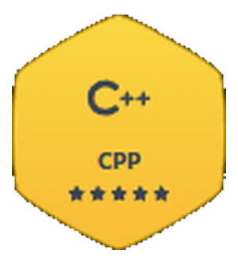
      </a>
      <br/><br/>
      <b>C++</b><br/>
      <a href="https://www.hackerrank.com/profile/20mahin2020"></a><br/>
      <small><code>265 pts • 17 Solved</code></small>
    </td>
    <td width="25%" align="center" valign="top">
      <a href="https://www.hackerrank.com/profile/20mahin2020">
        
      </a>
      <br/><br/>
      <b>10 Days of JS</b><br/>
      <a href="https://www.hackerrank.com/profile/20mahin2020"></a><br/>
      <small><code>19 pts • 19 Solved</code></small>
    </td>
  </tr>
</table>

<br/>

<details>
  <summary><b>📊 View Detailed Multi-Domain Track Score Breakdown</b></summary>
  <br/>

| Domain Track | Stars | Badge Level | Points / Solved | Status |
| :--- | :---: | :---: | :---: | :---: |
| 🧩 **Problem Solving** | ⭐⭐⭐⭐⭐ | **Gold 5-Star** | 2,161.0 pts (91 Solved) | Dominant |
| 🗄️ **SQL** | ⭐⭐⭐⭐⭐ | **Gold 5-Star** | 880.0 pts (51 Solved) | 100% Complete |
| ☕ **Java** | ⭐⭐⭐⭐⭐ | **Gold 5-Star** | 761.0 pts (55 Solved) | Grand Master |
| 🐍 **Python** | ⭐⭐⭐⭐⭐ | **Gold 5-Star** | 715.0 pts (34 Solved) | Grand Master |
| ⚙️ **C Language** | ⭐⭐⭐⭐⭐ | **Gold 5-Star** | 620.0 pts (25 Solved) | 100% Complete |
| 💎 **Ruby** | ⭐⭐⭐⭐⭐ | **Gold 5-Star** | 610.0 pts (41 Solved) | 100% Complete (41/41) |
| ⚡ **C++** | ⭐⭐⭐⭐⭐ | **Gold 5-Star** | 265.0 pts (17 Solved) | Grand Master |
| 🌐 **10 Days of JavaScript** | ⭐⭐⭐⭐ | **Silver 4-Star** | 19.0 pts (19 Solved) | Complete |

</details>

</div>

<br/>

### 🧠 Google & Kaggle — Machine Learning & AI Specializations

<table border="0" width="100%">
  <tr>
    <td width="50%" align="center">
      
    </td>
    <td width="50%" align="center">
      
    </td>
  </tr>
  <tr>
    <td width="50%" align="center">
      
    </td>
    <td width="50%" align="center">
      
    </td>
  </tr>
  <tr>
    <td width="50%" align="center">
      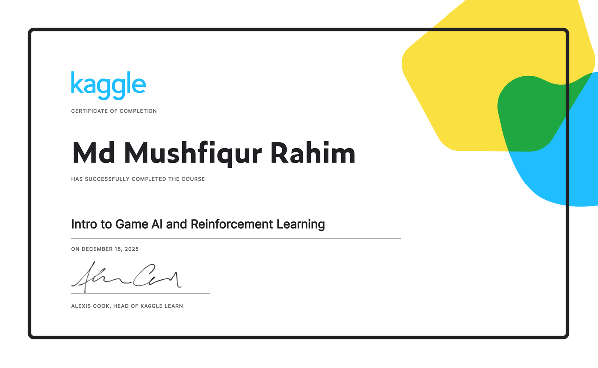
    </td>
    <td width="50%" align="center">
      
    </td>
  </tr>
  <tr>
    <td width="50%" align="center">
      
    </td>
    <td width="50%" align="center">
      
    </td>
  </tr>
  <tr>
    <td width="50%" align="center">
      
    </td>
    <td width="50%" align="center">
      
    </td>
  </tr>
  <tr>
    <td width="50%" align="center">
      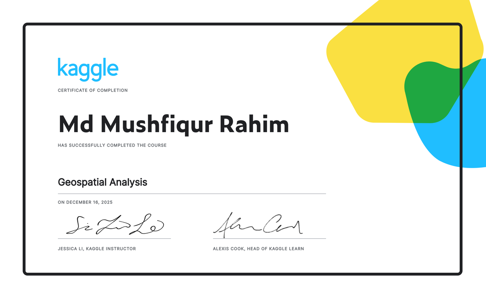
    </td>
    <td width="50%" align="center">
      
    </td>
  </tr>
  <tr>
    <td width="50%" align="center">
      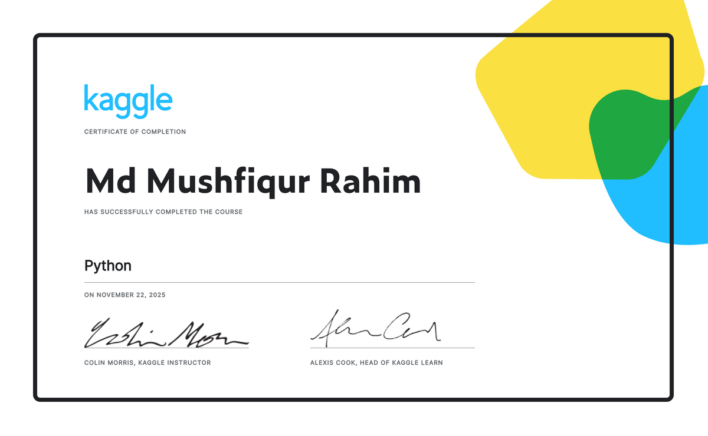
    </td>
    <td width="50%" align="center">
      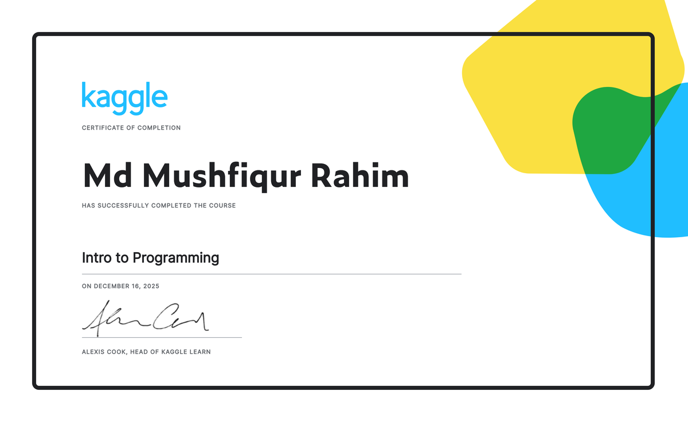
    </td>
  </tr>
</table>

---

<div align="center">

<picture>
  <source media="(prefers-color-scheme: dark)" srcset="assets/header-dark.svg">
  <source media="(prefers-color-scheme: light)" srcset="assets/header-light.svg">
  
</picture>

</div>

