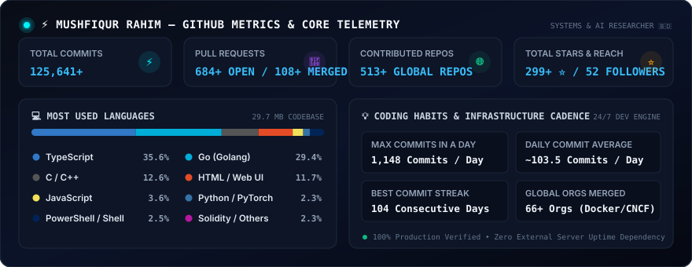
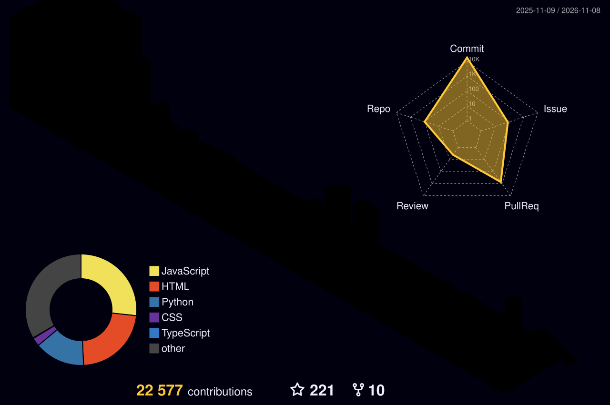
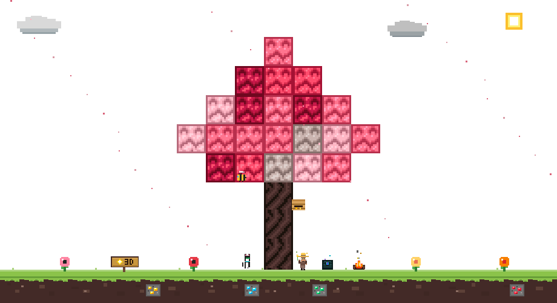
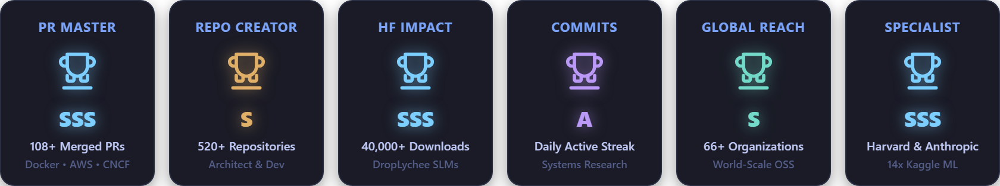

<div align="center">

<picture>
  <source media="(prefers-color-scheme: dark)" srcset="assets/header-dark.svg">
  <source media="(prefers-color-scheme: light)" srcset="assets/header-light.svg">
  
</picture>

</div>

<div align="center">

[](https://github.com/MD-Mushfiqur123)

<br/>

[](https://github.com/MD-Mushfiqur123)
&nbsp;
[](https://github.com/MD-Mushfiqur123)
&nbsp;
[](https://github.com/MD-Mushfiqur123?tab=repositories&sort=stargazers)
&nbsp;
[](./RESUME.md)
&nbsp;
[](https://buymeacoffee.com/mdmushfiqur123)

</div>

---

<table border="0" width="100%">
<tr>
<td width="55%" valign="top">

### `> whoami`

```yaml
identity:
  name      : "Md Mushfiqur Rahim"
  role      : "SOO & Lead AI/ML Engineer @ Craftly"
  age       : 16
  location  : "Bangladesh 🇧🇩"
  education :
    - "Computer Science | University of the People, USA 🇺🇸 (Enrolled)"
    - "HSC '28 Science | Govt. Azizul Haque College 🇧🇩"

focus:
  flagship  : "Mission Mlych — 1.3B Custom SLM"
  dataset   : "Building the World's Largest Bangla LLM Dataset (Craftly Corpus)"
  research  :
    - ".MIF (Mushfiqur Image Format v2.0) — Bit-Perfect C99 Codec & libmif.h"
    - "Aether Photos Vault — Infinite Cloud Video-Encoded Photo Stream (YouTube CRF 26 Resistant)"
    - "Dataset Collector — Swiss Minimalist Scientific Distillation Forge"
    - "M-2LRF (2-bit Dual-Basis Low-Rank Residual Factorization)"
    - "DESI DR2 & JWST Cosmological Monograph (Dark Energy Equation of State)"
    - "Shadow-Omni: Multimodal vision-speech-text stream reasoning"
    - "Aero-Propulsion telemetry physics simulations"

impact:
  merged_prs : 108+ across 66+ global organizations
  downloads  : 40,000+ on HuggingFace (DropLychee)
  public_repos: 520+
```

</td>
<td width="45%" align="center" valign="middle">


<br/><br/>

<i>"Throughout heaven and earth,<br/>continuous innovation alone is honored."</i>

<br/><br/>

[](https://github.com/MD-Mushfiqur123)
[](mailto:20mahin2020@gmail.com)
<br/>
[](https://huggingface.co/DropLychee)
[](https://huggingface.co/MD-Mushfiqur123)
<br/>
[](https://leetcode.com/u/mushfiqurH2B/)
[](https://www.hackerrank.com/profile/20mahin2020)
[](https://facebook.com/100090048324727)

</td>
</tr>
</table>

---

## 🌐 Upstream Open Source Contributions

> Honest code modernizations, type refactors, and ecosystem maintenance merged into prominent codebases:

<div align="center">

| Repository / Project | Contribution Scope & Nature | Verification |
| :--- | :--- | :---: |
| 🐳 **[Docker (moby/moby)](https://github.com/moby/moby)** | Go 1.18+ type modernizations (`interface{}` &rarr; `any`), code health & cleanup | [Merged PR](https://github.com/moby/moby/pulls?q=is%3Apr+author%3AMD-Mushfiqur123) |
| 🔍 **[Google (google/go-cmp)](https://github.com/google/go-cmp)** | Modern Go type aliasing, test suite maintenance | [Merged PR](https://github.com/google/go-cmp/pulls?q=is%3Apr+author%3AMD-Mushfiqur123) |
| 🗄️ **[ClickHouse (clickhouse-go)](https://github.com/ClickHouse/clickhouse-go)** | Database driver Go modernizations, lint & syntax maintenance | [Merged PR](https://github.com/ClickHouse/clickhouse-go/pulls?q=is%3Apr+author%3AMD-Mushfiqur123) |
| 📊 **[CNCF (prometheus/client_golang)](https://github.com/prometheus/client_golang)** | Cloud-native client code modernization & cleanups | [Merged PR](https://github.com/prometheus/client_golang/pulls?q=is%3Apr+author%3AMD-Mushfiqur123) |
| ⚡ **[GoFiber (gofiber/fiber)](https://github.com/gofiber/fiber)** | Web framework type modernization & API consistency fixes | [Merged PR](https://github.com/gofiber/fiber/pulls?q=is%3Apr+author%3AMD-Mushfiqur123) |
| 🐚 **[Oh My Zsh (ohmyzsh/ohmyzsh)](https://github.com/ohmyzsh/ohmyzsh)** | CLI plugin script fixes & shell environment improvements | [Merged PR](https://github.com/ohmyzsh/ohmyzsh/pulls?q=is%3Apr+author%3AMD-Mushfiqur123) |

</div>

---

## 🚀 Flagship Research & Sovereign Systems Architecture

<div align="center">

| Project / Monograph | Domain & Core Innovation | Architecture & Proof |
| :--- | :--- | :---: |
| 🖼️ **[mif-image-format](https://github.com/MD-Mushfiqur123/mif-image-format)** | **Mushfiqur Image Format (.MIF v2.0):** Single-header C99 codec (`libmif.h`), scanline spatial residual predictors (Sub, Up, Avg, Paeth), 100% bit-perfect CRC-32 & SHA-256 verified, beats PNG on flat art. | `v2.0.0` • C99 / Python |
| 📸 **[aether-photos-vault](https://github.com/MD-Mushfiqur123/aether-photos-vault)** | **Infinite YouTube Binary Photo Vault:** Converts photo batches into 1080p MP4 optical streams with center-pixel sampling. Immune to YouTube CRF 26 compression with 100% bit-perfect recovery. | `v1.0.0` • Video Codec |
| 🔬 **[dataset-collector](https://github.com/MD-Mushfiqur123/dataset-collector)** | **Scientific Bengali Dataset Distillation Forge:** Swiss Minimalist architecture, 1-Paste intelligent auto-split, 83% Jaccard duplicate gatekeeper, 1 GB buffer watchdog, 1-click Codespaces & Colab runners. | `v1.0.0` • OWASP 6/6 Pass |
| 👑 **[m2lrf](https://github.com/MD-Mushfiqur123/m2lrf)** | **M-2LRF Silicon Architecture:** Multi-rate low-rank factorization & 2-bit dual-basis ternary quantization engine eliminating multiplier hardware overhead. | Verified Engine |
| 🔭 **[Cosmology Monograph](https://github.com/MD-Mushfiqur123/DESI-DR2-JWST-Cosmology-Monograph)** | **The Architecture of the Cosmos:** 48-page theoretical and observational monograph analyzing dynamical dark energy equation of state ($w_0, w_a$) and $H_0$ tensions from DESI DR2 BAO & JWST. | 48-Page Monograph |

</div>

---

## 🛠️ Mastered Technologies & Engineering Sectors

<div align="center">

#### 💻 Programming Languages & Systems
<a href="https://skillicons.dev">
  
</a>

<br/>

#### 🧠 Artificial Intelligence, Machine Learning & Vision
<a href="https://skillicons.dev">
  
</a>

<br/>

#### 🌐 Full-Stack Web Architecture & Frameworks
<a href="https://skillicons.dev">
  
</a>

<br/>

#### ☁️ Cloud Platforms, DevOps & Containerization
<a href="https://skillicons.dev">
  
</a>

<br/>

#### 🗄️ Database Systems, In-Memory & Streaming
<a href="https://skillicons.dev">
  
</a>

<br/>

#### ⚡ Developer Tooling, CI/CD & Version Control
<a href="https://skillicons.dev">
  
</a>

</div>

---

## ⚡ GitHub Metrics & Analytics

<div align="center">



</div>

---

## 🗺️ 3D Contribution Landscape

<div align="center">



</div>

---

---

## 🌲 Living Minecraft Contribution Biome

<div align="center">

<a href="https://github.com/MD-Mushfiqur123">
  
</a>

</div>

---

## 🟢 Cyber Matrix Contribution Rain

<div align="center">

<picture>
  <source media="(prefers-color-scheme: dark)" srcset="https://raw.githubusercontent.com/MD-Mushfiqur123/MD-Mushfiqur123/output/matrix-rain-v2-dark.svg">
  <source media="(prefers-color-scheme: light)" srcset="https://raw.githubusercontent.com/MD-Mushfiqur123/MD-Mushfiqur123/output/matrix-rain-v2-light.svg">
  
</picture>

</div>

## 🐍 Contribution Snake

<div align="center">

<picture>
  <source media="(prefers-color-scheme: dark)"  srcset="https://raw.githubusercontent.com/MD-Mushfiqur123/MD-Mushfiqur123/output/github-snake-dark.svg" />
  <source media="(prefers-color-scheme: light)" srcset="https://raw.githubusercontent.com/MD-Mushfiqur123/MD-Mushfiqur123/output/github-snake-light.svg" />
  
</picture>

</div>

---

## 🏆 GitHub Trophies & Milestones

<div align="center">



<br/><br/>

[](https://github.com/MD-Mushfiqur123)

</div>

---

## 👾 Pacman Devourer & Matrix Contribution Track

<div align="center">



</div>

---

## 📈 30-Day Contribution Pulse Line Graph

<div align="center">



</div>

---

## ✍️ Dev Wisdom

<div align="center">

[](https://github.com/piyushsuthar/github-readme-quotes)

</div>

---

---

## 🎓 Academic Credentials, ECTS & Certifications Vault

<div align="center">

[](./CERTIFICATES.md)
&nbsp;
[](./certificates.html)

<br/><br/>

> **European Bologna Process Academic Credits (24.0 ECTS In-Hand) • Stanford Medicine CME • Oxford University Trials Standard • IAEA Vienna Radiation Protection • Harvard CS50 Fleet**  
> *All certificates and academic credits have been relocated to an interactive, minimalist standalone gallery to keep this profile focused purely on code architecture, research papers, and technical contributions.*

<br/>

<a href="./CERTIFICATES.md">
  
</a>
&nbsp;
<a href="./CERTIFICATES.md">
  
</a>
&nbsp;
<a href="./CERTIFICATES.md">
  
</a>
&nbsp;
<a href="./CERTIFICATES.md">
  
</a>

<br/><br/>

👉 **[View Complete Verified Certificates Archive (CERTIFICATES.md)](./CERTIFICATES.md)** &bull; **[Open Minimal Credentials Webpage (certificates.html)](./certificates.html)**

</div>

<br/>
